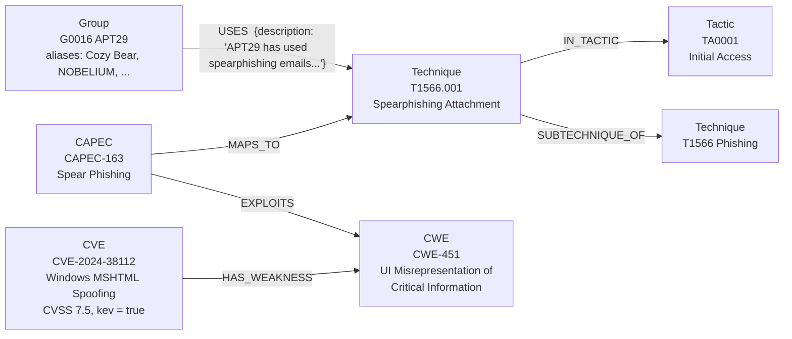
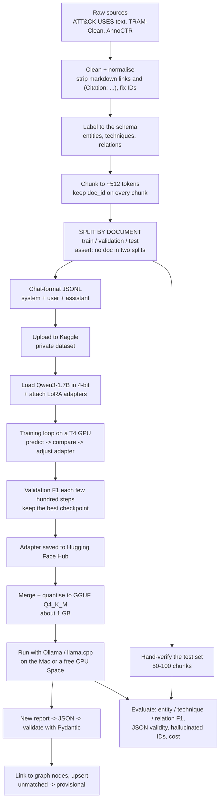

# Visualizer — from raw files to graph to fine-tuned model

Everything marked **REAL** below was read directly from the files in `data/raw/` (nothing has been ingested into Neo4j yet). Things marked **ILLUSTRATIVE** are made up to explain a concept.

---

## 0. TL;DR

> **Status (2026-10-21): Phases 0–6 are done; Phase 7 is next.** The sections below were written before the build; where the build turned out differently they are corrected, and the final numbers are in `evals/results/data_quality.md`.

- **The downloaded data is what we expected, and nothing needs manual extraction.** We read the `.zip` and `.gz` files directly from Python as streams. No unzipping by hand.
- **There are 5 surprises** where real v20 data differs from the playbook (section 1.2). None blocks the project, but they change a few details.
- **The graph** is built by reading each file, turning records into typed nodes, and joining them on shared IDs (`T1566.001`, `CAPEC-163`, `CWE-451`, `CVE-2024-38112`).
- **Fine-tuning** means showing a small pre-trained model several thousand examples of "text in → JSON out" until it reliably produces that JSON by itself. Section 5 explains it from zero.

---

## 1. Is the downloaded data as expected?

### 1.1 What each file is and how we read it

| File in `data/raw/` | Size | Format | Extraction needed? | Records (REAL) |
|---|---|---|---|---|
| `enterprise-attack-20.0.json` | 55 MB | One STIX JSON bundle | No. `json.load` | 26,690 objects: 21,819 relationships, 867 techniques, 750 malware, 268 mitigations, 193 groups, 95 tools, 57 campaigns, 15 tactics, plus new object kinds (see below) |
| `cwec_latest.xml.zip` | 2 MB | Zip holding `cwec_v4.20.xml` | Read from the zip in memory (`zipfile`) | 969 weaknesses (25 deprecated) |
| `capec_latest.xml` | 4 MB | XML, CAPEC v3.9 | No | 615 attack patterns |
| `nvdcve-2.0-YYYY.json.gz` (2002 → 2026, + `modified`) | 318 MB total | One JSON document per year, gzipped | Stream-decompress with `gzip.open` | e.g. 2025 file: 45,397 CVE records |
| `known_exploited_vulnerabilities.json` | 1.8 MB | JSON | No | 1,754 CVEs known to be exploited |

### 1.2 Surprises vs the playbook (all verified in the files)

| # | Playbook assumed | Reality in v20 / current data | What we do |
|---|---|---|---|
| 1 | Techniques link to CAPEC through ATT&CK `external_references` (source `capec`) | **Zero** live techniques carry a `capec` reference in v20. The only technique→CAPEC links come from CAPEC's own `Taxonomy_Mapping` | `MAPS_TO` comes from CAPEC only; `via` is always `["capec"]`. Drop the "ATT&CK side" code path or keep it as a no-op |
| 2 | Technique has a `detection` property | The key doesn't exist on techniques. v20 moved this into new objects (`x-mitre-detection-strategy` 705, `x-mitre-analytic` 1,770, `x-mitre-data-component` 109) | Skip `detection` for now; optionally ingest these later |
| 3 | CAPEC's ATT&CK IDs all resolve | Some point at techniques that are now revoked/deprecated, e.g. `T1562.001`, `T1513` | Drop mappings whose technique isn't live, and count how many were dropped |
| 4 | Most things connect | Only **179 of 706** live techniques (25.4%) have any CAPEC link. For APT29, **20 of its 66** techniques do | The multi-hop chain exists but is sparse. We report it as a finding |
| 5 | NVD is mostly clean | In the 2025 file: 1,788 are `Rejected`; 17,264 are `Deferred` (not analysed); 883 have only pseudo-weaknesses (`NVD-CWE-Other`/`noinfo`); 2,630 have no weakness data | Skip rejected, filter pseudo-CWEs, report CVE→CWE coverage |

Also confirmed: ATT&CK has 157 revoked and 289 deprecated objects to skip; CAPEC writes ATT&CK IDs without the `T` prefix (`1566.001`); a CVE can list several CWEs, labelled `Primary` or `Secondary`.

---

## 2. Raw examples (REAL), one per dataset, and what we keep

### 2.1 ATT&CK: a group (APT29)
```json
{
  "type": "intrusion-set",
  "id": "intrusion-set--899ce53f-13a0-479b-a0e4-67d46e241542",
  "name": "APT29",
  "aliases": ["APT29","IRON RITUAL","IRON HEMLOCK","NobleBaron","Dark Halo","NOBELIUM",
              "UNC2452","YTTRIUM","The Dukes","Cozy Bear","CozyDuke","SolarStorm",
              "Blue Kitsune","UNC3524","Midnight Blizzard"],
  "external_references": [{"source_name": "mitre-attack", "external_id": "G0016", "...": "..."}],
  "description": "[APT29](https://attack.mitre.org/groups/G0016) is threat group that has been attributed to Russia's Foreign Intelligence Service (SVR)..."
}
```
**Keep:** `attack_id=G0016`, `name`, `aliases[]` (this is how "Cozy Bear" resolves to APT29), `description` (with markdown links and `(Citation: …)` stripped), `stix_id` (needed to resolve relationships).

### 2.2 ATT&CK: a technique (T1566.001)
```json
{
  "type": "attack-pattern",
  "id": "attack-pattern--…",
  "name": "Spearphishing Attachment",
  "external_references": [{"source_name": "mitre-attack", "external_id": "T1566.001"}],
  "kill_chain_phases": [{"kill_chain_name": "mitre-attack", "phase_name": "initial-access"}],
  "x_mitre_is_subtechnique": true,
  "x_mitre_platforms": ["Linux", "macOS", "Windows"],
  "revoked": false, "x_mitre_deprecated": false
}
```
**Keep:** `attack_id`, `name`, `description`, `is_subtechnique`, `platforms[]`. `kill_chain_phases[].phase_name` becomes an `IN_TACTIC` edge to the tactic whose `x_mitre_shortname` is `initial-access` (TA0001 Initial Access).

### 2.3 ATT&CK: a relationship (the "procedure example")
```json
{
  "type": "relationship",
  "relationship_type": "uses",
  "source_ref": "intrusion-set--899ce53f-…",
  "target_ref": "attack-pattern--… (T1566.001)",
  "description": "[APT29](https://attack.mitre.org/groups/G0016) has used spearphishing emails with an attachment to deliver files with exploits to initial victims.(Citation: F-Secure The Dukes)(Citation: MSTIC NOBELIUM May 2021)..."
}
```
**Keep:** an edge `(G0016)-[:USES {description: "APT29 has used spearphishing emails with an attachment…"}]->(T1566.001)`. The `description` is gold: it is both the explanation shown in answers and the **training text for fine-tuning** (section 5).

### 2.4 CWE: a weakness (CWE-451)
```xml
<Weakness ID="451" Name="User Interface (UI) Misrepresentation of Critical Information"
          Abstraction="Class" Status="Draft"> ... </Weakness>
```
For CWE-89 (SQL injection) we also see `Related_Weakness Nature="ChildOf" CWE_ID="943"` and `CWE_ID="74"`, which become `(CWE-89)-[:CHILD_OF]->(CWE-943)`.
**Keep:** `cwe_id=CWE-451`, `name`, `description`, `abstraction`. Skip `Status="Deprecated"`.

### 2.5 CAPEC: an attack pattern (CAPEC-163), the bridge
```xml
<Attack_Pattern ID="163" Name="Spear Phishing" Status="Draft">
  <Related_Weaknesses><Related_Weakness CWE_ID="451"/></Related_Weaknesses>
  <Taxonomy_Mappings>
    <Taxonomy_Mapping Taxonomy_Name="ATTACK"><Entry_ID>1566.001</Entry_ID></Taxonomy_Mapping>
    <Taxonomy_Mapping Taxonomy_Name="ATTACK"><Entry_ID>1566.002</Entry_ID></Taxonomy_Mapping>
    <!-- also 1534, 1566.003, 1598.001–003 -->
  </Taxonomy_Mappings>
</Attack_Pattern>
```
**Keep:** node `CAPEC-163`; edge `(CAPEC-163)-[:EXPLOITS]->(CWE-451)`; edges `(CAPEC-163)-[:MAPS_TO]->(T1566.001)` etc. **Normalise** `1566.001` → `T1566.001` first, or the join silently fails.

### 2.6 NVD: a CVE (CVE-2024-38112)
```json
{ "cve": {
    "id": "CVE-2024-38112",
    "published": "2024-07-09T…",
    "vulnStatus": "Analyzed",
    "descriptions": [{"lang": "en", "value": "Windows MSHTML Platform Spoofing Vulnerability"}],
    "metrics": {"cvssMetricV31": [{"cvssData": {"baseScore": 7.5, "baseSeverity": "HIGH"}}]},
    "weaknesses": [{"type": "Primary", "description": [{"value": "CWE-451"}, {"value": "NVD-CWE-Other"}]}]
} }
```
**Keep:** `cve_id`, English description, the best CVSS score with its version (`cvss_score=7.5`, `cvss_version="3.1"`, `cvss_severity="HIGH"`; v3.1 is preferred, then 4.0, 3.0, 2.0), `published`. `CWE-451` → edge `(CVE-2024-38112)-[:HAS_WEAKNESS]->(CWE-451)`. `NVD-CWE-Other` is a pseudo-CWE: filtered out.

### 2.7 CISA KEV: the "actively exploited" flag
```json
{ "cveID": "CVE-2025-0282", "vendorProject": "Ivanti",
  "dateAdded": "2025-01-08", "knownRansomwareUse": "Known", "...": "..." }
```
**Keep:** match on `cveID`, then set `kev=true`, `kev_date_added`, `known_ransomware_use` on the existing CVE node. (In the 2025 NVD file, 189 CVEs are on the KEV list.)

---

## 3. Mock ingestion: how the graph is assembled

### 3.1 The join keys
```
 ATT&CK                   CAPEC                     CWE               NVD / KEV
 ──────                   ─────                     ───               ─────────
 Group G0016                                                              
   │ USES                                                                 
   ▼                                                                      
 Technique T1566.001 ◀── MAPS_TO ── CAPEC-163 ── EXPLOITS ──▶ CWE-451 ◀── HAS_WEAKNESS ── CVE-2024-38112
                            (key: "T"+Entry_ID)    (key: CWE_ID)      (key: "CWE-451" string)   (kev = true from KEV file)
```
Every hop is a plain ID match. The graph database just makes those matches permanent and fast to walk.

### 3.2 Steps (the order matters)
1. **ATT&CK:** drop the 157 revoked and 289 deprecated objects → build a `stix_id → attack_id` map → create nodes (Group, Technique, Tactic, Software, Mitigation, Campaign) → translate `relationship` objects using that map → build `IN_TACTIC` from `kill_chain_phases`.
2. **CWE:** create `CWE` nodes, then `CHILD_OF` edges.
3. **CAPEC:** create `CAPEC` nodes → `EXPLOITS` edges to CWE → `MAPS_TO` edges to techniques (after adding the `T` prefix and dropping non-live techniques).
4. **NVD:** stream each yearly file → create `CVE` nodes (skip `Rejected`) → `HAS_WEAKNESS` only where the CWE node exists.
5. **KEV:** set the `kev` fields on existing CVE nodes.
6. **Embeddings:** compute a 384-number vector (`BAAI/bge-small-en-v1.5`) for each concept node and for the 106,111 CVEs that are KEV or on the chain, and store it on the node. Concepts go in the `ref_vec` index and CVEs in `cve_vec`, because 394K CVEs would otherwise crowd the 3.3K concept nodes out of every search. A separate `text_search` full-text index handles exact names and aliases.

### 3.3 What ends up in Neo4j (the real chain, as a picture)



As Neo4j would store the nodes (properties shortened):
```
(:Group:Searchable      {uid:"Group:G0016", attack_id:"G0016", name:"APT29", aliases:[...], source:"mitre-attack", source_version:"20.0"})
(:Technique:Searchable  {uid:"Technique:T1566.001", attack_id:"T1566.001", name:"Spearphishing Attachment", is_subtechnique:true})
(:CAPEC:Searchable      {uid:"CAPEC:CAPEC-163", capec_id:"CAPEC-163", name:"Spear Phishing"})
(:CWE:Searchable        {uid:"CWE:CWE-451", cwe_id:"CWE-451", name:"User Interface (UI) Misrepresentation of Critical Information"})
(:CVE:Searchable        {uid:"CVE:CVE-2024-38112", cve_id:"CVE-2024-38112", cvss_score:7.5, cvss_version:"3.1", cvss_severity:"HIGH", kev:true})
(every non-CVE node above also carries the label :Reference, which is what ref_vec indexes)
```

### 3.4 The question this answers
> "Which actively exploited CVEs relate to techniques APT29 uses?"

```cypher
MATCH p=(g:Group {attack_id:'G0016'})-[:USES]->(t:Technique)<-[:MAPS_TO]-(c:CAPEC)
        -[:EXPLOITS]->(w:CWE)<-[:HAS_WEAKNESS]-(v:CVE {kev:true})
RETURN t.attack_id, c.capec_id, w.cwe_id, v.cve_id LIMIT 50;
```
A row it returns (**REAL**, I confirmed this chain exists in the data):

| technique | capec | cwe | cve |
|---|---|---|---|
| T1566.001 | CAPEC-163 | CWE-451 | CVE-2024-38112 |

In the finished graph, APT29 reaches **305 chains, 16 techniques, 21 CWEs and 235 distinct KEV CVEs** (measured with the Cypher query above). Plain vector search can't produce this, because no document states the whole chain.

### 3.5 Honest caveats about this chain (important for the README)
- **It's sparse.** Only 25.4% of techniques (179/706) have a CAPEC link, and 20 of APT29's 66 techniques.
- **Some links are weak.** The join goes through whatever CWE a CAPEC pattern lists. For example `T1037 Boot or Logon Initialization Scripts → CAPEC-564 → CWE-284 → CVE-2025-12480` is connected only through the very generic CWE-284 "Improper Access Control". The graph is correct about the *link*, but it doesn't mean APT29 used that CVE. The answer text must say "weakness-level association, not observed exploitation."
- **A precise exploit claim needs a different source.** The only direct "actor exploited this CVE" evidence is free text, such as the `USES` description for T1190: *"APT29 has exploited CVE-2019-19781 for Citrix, CVE-2019-11510 for Pulse Secure VPNs…"*. Extracting those CVE mentions from text is exactly what the fine-tuned extractor (section 5) is for.

---

## 4. How the graph is then used (one paragraph)

The agent receives a question, resolves names to IDs ("Cozy Bear" → G0016 using the **full-text index on names and aliases**; vector search cannot look up a bare name), picks a route (graph walk, vector search, both, or live CVE lookup), calls read-only tools on the MCP server, and writes an answer that cites the IDs and the path it walked. A deterministic check rejects any cited ID that isn't in the evidence it retrieved.

---

## 5. Fine-tuning from zero

### 5.1 The idea in plain words
- A **language model** is a very large function that, given text, predicts the next piece of text. **Qwen3-1.7B** has 1.7 billion adjustable numbers ("weights"), already trained on a huge amount of general text.
- **Fine-tuning** continues training on a *small, specialised* set of examples, so the model gets good at one narrow job. Our job: *read a paragraph of a threat report and output a fixed JSON structure* (actors, malware, CVEs, ATT&CK techniques, relations).
- Why not just prompt a big model? That works, but costs money per call and needs the internet. A fine-tuned 1.7B model runs free on a laptop CPU. The project measures the trade-off honestly (Phase 10), including cases where fine-tuning loses.

### 5.2 What one training example looks like
**Input (a chunk of text):** a real ATT&CK procedure sentence, cleaned of the markdown link and citations.
> APT29 has used spearphishing emails with an attachment to deliver files with exploits to initial victims.

**Target output (what we want the model to produce)** (ILLUSTRATIVE formatting; the content is derived from the real edge `G0016 -USES-> T1566.001`):
```json
{"entities":[{"text":"APT29","type":"THREAT_ACTOR","attack_id":"G0016"}],
 "techniques":[{"attack_id":"T1566.001","evidence":"spearphishing emails with an attachment"}],
 "relations":[{"head":"APT29","relation":"USES","tail":"T1566.001"}]}
```
**Stored as one line of a chat-format JSONL file:**
```json
{"messages":[
 {"role":"system","content":"Extract CTI entities, ATT&CK techniques and relations as JSON matching the schema."},
 {"role":"user","content":"APT29 has used spearphishing emails with an attachment to deliver files with exploits to initial victims."},
 {"role":"assistant","content":"{\"entities\":[{\"text\":\"APT29\",\"type\":\"THREAT_ACTOR\",\"attack_id\":\"G0016\"}],\"techniques\":[{\"attack_id\":\"T1566.001\",\"evidence\":\"spearphishing emails with an attachment\"}],\"relations\":[{\"head\":\"APT29\",\"relation\":\"USES\",\"tail\":\"T1566.001\"}]}"}
]}
```

### 5.3 Where the training data comes from
| Source | Gives | Status |
|---|---|---|
| **ATT&CK `USES` descriptions** (already downloaded) | **17,636** sentences that link an actor/malware/tool/campaign to a technique (10,739 malware, 4,815 group, 1,213 campaign, 869 tool). Labels are known from the edge itself, so no manual labelling | Available now |
| TRAM-Clean | Sentences labelled with technique IDs | To download in Phase 8; verify the source and licence |
| AnnoCTR | 120 real annotated reports (entities + ATT&CK concepts) | To download in Phase 8; verify the licence |

**Caveat that matters:** ATT&CK descriptions are short, edited, tidy sentences. Real threat reports are long, messy and full of noise. A model trained mostly on tidy sentences may do worse on real reports. That's why the hand-verified test set uses held-out **real report chunks** (AnnoCTR/TRAM), and why Phase 10 compares against the base model and an API model.

### 5.4 Pipeline flow (end to end)



### 5.5 What happens inside the training loop (the part that feels like magic)
For each batch of examples:
1. **Forward pass:** the model reads the `system` + `user` text and predicts the `assistant` text one token at a time.
2. **Loss:** compare each predicted token to the real one. Wrong → big number, right → small number. Average it. This is the **loss**.
3. **Backward pass:** work out which tiny adapter weights, nudged which way, would have lowered the loss.
4. **Update:** nudge them a little (the **learning rate**, `2e-4` here).
5. Repeat for every batch. One full pass over the data is an **epoch** (we plan about 2).

You watch one curve: the loss should fall, then flatten. If it doesn't fall, something's wrong (wrong data format, wrong learning rate). That's why the playbook says to **run a 50-step debug on 200 examples first**.

### 5.6 The three tricks that make it fit on a free GPU
| Term | Plain meaning | Why we use it |
|---|---|---|
| **4-bit quantisation** | Store the frozen base weights with ~4 bits each instead of 16 | The 1.7B base shrinks to about 1–1.5 GB of GPU memory |
| **LoRA** | Don't touch the 1.7B base weights. Add small trainable "adapter" matrices beside the attention/MLP layers and train only those (rank `r=16`) | We train well under 1% of the numbers. The result is a small adapter file |
| **QLoRA** | LoRA on top of a 4-bit base | Fits the free Kaggle T4 (about 16 GB) comfortably |

Other knobs in the playbook and what they mean: `train_on_responses_only` means only the JSON answer counts toward the loss, not the prompt text; `enable_thinking=False` stops Qwen3 from writing long reasoning before the JSON, which would break parsing; `fp16=True, bf16=False` because T4 GPUs don't support bf16 and would give `NaN` loss.

### 5.7 What you get and how it's checked
- **Output of training:** an *adapter* (tens of MB), not a new 1.7B model. Merged with the base and shrunk to GGUF Q4_K_M, it is about 1 GB.
- **Before vs after** (ILLUSTRATIVE, not a real run; the real comparison is Phase 10):

| Input: "APT29 used spearphishing attachments." | Base Qwen3-1.7B, prompted | Fine-tuned |
|---|---|---|
| Output style | Often prose, or JSON with different key names | JSON in exactly our schema |
| Technique ID | May invent one that doesn't exist | Picks from IDs it saw in training |
| Cost/latency | Same model, but needs a long prompt with examples | Short prompt, same speed |

- **Metrics we report:** entity F1, technique F1, relation F1, JSON-validity %, **hallucinated-ID %** (checked against the real graph), latency, and cost per 1K documents, compared with the base model (zero-shot and 3-shot) and one API model.
- **The biggest trap:** if sentences from the same report land in both train and test, scores look great and mean nothing. Splitting **by document**, enforced with an assert, prevents that.

### 5.8 Rough effort (estimates, not measured)
- Dataset: 3–6K training examples at roughly 300–600 tokens each, so a few million tokens per epoch.
- On a free Kaggle T4 with Unsloth, a 1.7B QLoRA run for 2 epochs should take tens of minutes to a couple of hours. We'll know the real number after the 50-step debug run.
- Kaggle sessions are time-limited, which is why the playbook uses "Save & Run All (Commit)" and checkpoints you can resume from.

---

## 6. Where each dataset is used, at a glance

| Dataset | Graph (P2) | Gold questions (P3) | Retrieval (P4–P7) | Fine-tuning (P8–P10) | Demo (P12) |
|---|---|---|---|---|---|
| ATT&CK v20 | Groups, techniques, tactics, software, mitigations, campaigns, 9 relationship types | Most questions | Core of the graph | `USES` descriptions = ~17.6K training sentences; technique IDs for validation | Subset graph |
| CAPEC | Bridge to CWE and techniques | Multi-hop | Multi-hop paths | – | Subset graph |
| CWE | Weakness hierarchy | Multi-hop | Multi-hop paths | – | Subset graph |
| NVD | 200K+ CVE nodes | Multi-hop, aggregation | CVE endpoints and live lookup | CVE mentions as entity examples | Reachable-CVE subset |
| KEV | `kev` flag on CVEs | "Actively exploited" questions | Strong filter | – | Included in the subset |
